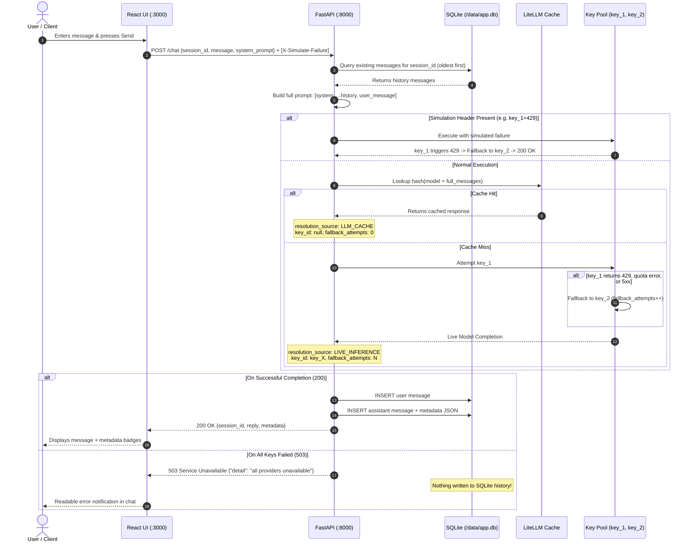

# Lyftr AI Full-Stack Assignment: LLM Chatbot with Key Failover & Response Caching

A production-grade, resilient AI chat application built with **React**, **FastAPI**, **LiteLLM**, and **SQLite**. Features automatic key pool failover, built-in response caching, multi-turn conversation persistence, per-request token tracking, and on-demand failure simulation.

---

## 1. Live URLs

| Field | URL / Value | Note |
| :--- | :--- | :--- |
| **Frontend URL** | `https://lyftr-chatbot.vercel.app` | Submit this in the form *(replace with your deployed URL)* |
| **Backend API Base URL** | `https://lyftr-chatbot-backend.onrender.com` | Submit this in the form *(replace with your deployed URL)* |
| **Backend Health Endpoint** | `https://lyftr-chatbot-backend.onrender.com/health` | Live health probe |
| **Public GitHub Repository** | `https://github.com/AditiVerma-code/lyftr-llm-chatbot` | Public repository |
| **2–3 Minute Demo Video** | `https://youtu.be/your-demo-video-id` | Screen recording with voiceover |

> **Note on Deployment:** Follow the deployment instructions in Section 2 to host the backend on Render/Railway and the frontend on Vercel/Cloudflare Pages.

---

## 2. Run locally: with Docker and without

### Option A: Run with Docker & Docker Compose (Recommended)

Prerequisites: Docker and Docker Compose installed.

1. **Clone the repository and prepare configuration:**
   ```bash
   git clone https://github.com/AditiVerma-code/lyftr-llm-chatbot.git
   cd lyftr-llm-chatbot
   cp .env.example .env
   ```

2. **Start the whole stack with `make up`:**
   ```bash
   make up
   ```
   * Or without make: `docker compose up -d --build`

3. **Verify the services:**
   - **Frontend:** [http://localhost:3000](http://localhost:3000)
   - **Backend API:** [http://localhost:8000](http://localhost:8000)
   - **Health Check:** [http://localhost:8000/health](http://localhost:8000/health)

4. **Stop the stack:**
   ```bash
   make down
   ```

---

### Option B: Run locally without Docker

Prerequisites: Python 3.11+ and Node.js 18+.

#### 1. Backend Setup
```bash
cd backend

# Create and activate virtual environment
python -m venv .venv

# On Linux/macOS:
source .venv/bin/activate
# On Windows (PowerShell):
.\.venv\Scripts\Activate.ps1

# Install dependencies
pip install -r requirements.txt

# Configure environment variables
# (Optionally set real Gemini/OpenAI API keys in LLM_API_KEYS)
export LLM_API_KEYS="mock_key_1,mock_key_2"
export DATABASE_URL="sqlite:///data/app.db"
export ENABLE_FAILURE_SIMULATION=true
export ALLOWED_ORIGINS="http://localhost:3000,http://127.0.0.1:3000,*"
export MOCK_LLM=true

# Start backend on http://localhost:8000
uvicorn app.main:app --host 0.0.0.0 --port 8000 --reload
```

#### 2. Frontend Setup
In a new terminal window:
```bash
cd frontend

# Install npm packages
npm install

# Start Vite dev server on http://localhost:3000
npm run dev
```

#### 3. Run Backend Test Suite
```bash
cd backend
python -m pytest -v
```

---

## 3. Design decisions: key fallback, caching, SQLite session storage

### System Architecture Overview

```mermaid
flowchart TD
    subgraph Client["Frontend Client (React + Vite)"]
        UI["Chat Interface\n(data-testid attributes)"]
        TB["Failover Simulation Toolbar\n(X-Simulate-Failure presets)"]
        SP["System Prompt Drawer\n(session-level override)"]
    end

    subgraph Gateway["FastAPI Backend Gateway (:8000)"]
        EP["Endpoints:\nGET /health\nPOST /chat\nGET /sessions/{id}/messages"]
        VAL["Input Validation Engine\n(Pydantic V2)"]
        CORS["CORS Middleware"]
    end

    subgraph Engine["LiteLLM Resilient Gateway"]
        CACHE{"LiteLLM Local Cache\n(Key: model + message history)"}
        ROUTER["Key Pool Failover Loop\n(key_1 -> key_2 -> ...)"]
        SIM["Simulation Evaluator\n(X-Simulate-Failure hook)"]
    end

    subgraph Storage["Persistence Layer"]
        SQLITE[("SQLite Database\n/data/app.db\n(messages table)")]
    end

    UI -->|POST /chat| EP
    TB -->|Injects X-Simulate-Failure| EP
    EP --> VAL
    VAL -->|Valid Payload| CACHE
    
    CACHE -->|Cache Hit| HIT["Return LLM_CACHE\n(latency < 5ms, key_id: null)"]
    CACHE -->|Cache Miss / Simulated| SIM
    
    SIM --> ROUTER
    ROUTER -->|Key 1 Fails (429/5xx)| ROUTER
    ROUTER -->|Key Succeeds| SUCC["Return LIVE_INFERENCE\n(key_id: key_X, latency_ms)"]
    ROUTER -->|All Keys Fail| ERR["Raise 503\n(all providers unavailable)"]
    
    HIT -->|Commit Success Only| SQLITE
    SUCC -->|Commit Success Only| SQLITE
    ERR -.->|No DB Commit on Error| SQLITE
    
    SQLITE -->|Read History| EP
    HIT --> UI
    SUCC --> UI
    ERR --> UI
```

---

### End-to-End Request & Failover Pipeline



---

### Detailed Architectural Decisions

#### 1. Key Fallback Architecture
- **Key Pool Representation:** Configured via `LLM_API_KEYS=keyA,keyB,...`. Evaluated sequentially with sanitized identifiers: `key_1`, `key_2`, etc.
- **Failover Logic:** The gateway iterates through the key pool in order. If a key encounters an HTTP 429 (rate limiting), quota exhaustion, or an HTTP 5xx error, it catches the exception, increments `fallback_attempts`, and automatically attempts the next key.
- **Zero Information Leakage:** API keys are never exposed in logs or responses; only safe identifiers (`key_1`, `key_2`) are returned.
- **Exhaustion Guard:** If all keys in the pool fail, the system cleanly raises an `AllProvidersUnavailableException`, returning an HTTP 503 with body `{"detail": "all providers unavailable"}` without crashing or dumping stack traces.
- **Failure Simulation (`X-Simulate-Failure`):** A custom hook simulates key failures (429, 500, 502, 503) per-request without consuming real provider quota, active only when `ENABLE_FAILURE_SIMULATION=true`.

#### 2. Response Caching Architecture
- **LiteLLM Native Cache:** Built-in local cache (`litellm.enable_cache(type="local")`) is enabled on startup.
- **Deterministic Cache Key:** The cache key is derived from the model name and the exact message sequence (`[system_prompt, ...history, new_message]`).
- **Cache Hit Contract:** When a cached reply is served:
  - `resolution_source` is reported strictly as `LLM_CACHE`.
  - `key_id` is returned as `null`.
  - `fallback_attempts` is returned as `0`.
  - Token counts reflect the stored prompt and completion tokens.
  - Server latency is substantially lower than a live inference call (< 5ms).
- **Simulation Isolation:** Requests with `X-Simulate-Failure` bypass the cache to guarantee that key failover mechanisms can be tested deterministically.

#### 3. SQLite Session Storage & Invariants
- **Zero External Dependencies:** Uses SQLite directly through standard Python libraries, requiring no Redis or PostgreSQL instances.
- **Data Persistence:** The database file is located at `DATABASE_URL` (defaulting to `/data/app.db` under a named Docker volume `sqlite_data`), persisting across container restarts.
- **Data Model:**
  ```sql
  CREATE TABLE messages (
    id INTEGER PRIMARY KEY AUTOINCREMENT,
    session_id TEXT NOT NULL,
    role TEXT NOT NULL,          -- 'user' or 'assistant'
    content TEXT NOT NULL,
    metadata TEXT,               -- JSON string with resolution_source, tokens, etc.
    created_at TEXT NOT NULL     -- ISO-8601 UTC timestamp
  );
  CREATE INDEX idx_messages_session ON messages (session_id, id);
  ```
- **Integrity Guarantee:** Only successfully completed requests are committed to SQLite. Failed requests (HTTP 422 or 503) are never written to the session history.
- **History Endpoint:** `GET /sessions/{session_id}/messages` returns the conversation ordered chronologically from oldest to newest without the system prompt, or returns HTTP 404 `{"detail": "session not found"}` for unknown sessions.

---

## 4. Verification: how to see failover, cache hits and per-message token usage

### 1. Verification of Health Check
```bash
curl -X GET http://localhost:8000/health
```
**Expected Response (200):**
```json
{
  "status": "ok",
  "keys_configured": 2,
  "cache_enabled": true
}
```

---

### 2. Verification of Cache Hit (`LLM_CACHE`)
Send the first message in session `s-1`:
```bash
curl -X POST http://localhost:8000/chat \
  -H "Content-Type: application/json" \
  -d '{"session_id": "s-1", "message": "What is the capital of France?"}'
```
**Response:** `resolution_source: "LIVE_INFERENCE"`, `key_id: "key_1"`, `fallback_attempts: 0`.

Send the exact same first message in a new session `s-2`:
```bash
curl -X POST http://localhost:8000/chat \
  -H "Content-Type: application/json" \
  -d '{"session_id": "s-2", "message": "What is the capital of France?"}'
```
**Response:** `resolution_source: "LLM_CACHE"`, `key_id: null`, `fallback_attempts: 0`, and latency is significantly lower!

---

### 3. Verification of Key Failover (`X-Simulate-Failure: key_1=429`)
```bash
curl -X POST http://localhost:8000/chat \
  -H "Content-Type: application/json" \
  -H "X-Simulate-Failure: key_1=429" \
  -d '{"session_id": "s-3", "message": "Testing automatic failover"}'
```
**Expected Response (200):**
```json
{
  "session_id": "s-3",
  "reply": "...",
  "metadata": {
    "resolution_source": "LIVE_INFERENCE",
    "model": "gemini-2.0-flash",
    "latency_ms": 12,
    "input_tokens": 10,
    "output_tokens": 20,
    "key_id": "key_2",
    "fallback_attempts": 1
  }
}
```
*Notice: `key_1` failed, `key_2` answered, and `fallback_attempts` is 1.*

---

### 4. Verification of All Providers Unavailable (`X-Simulate-Failure: *=429`)
```bash
curl -X POST http://localhost:8000/chat \
  -H "Content-Type: application/json" \
  -H "X-Simulate-Failure: *=429" \
  -d '{"session_id": "s-4", "message": "This request must fail completely"}'
```
**Expected Response (503):**
```json
{
  "detail": "all providers unavailable"
}
```
Verify that nothing was saved to history:
```bash
curl -X GET http://localhost:8000/sessions/s-4/messages
```
**Expected Response (404):**
```json
{
  "detail": "session not found"
}
```

---

### 5. Verification via Web UI
Open [http://localhost:3000](http://localhost:3000) in your browser:
1. Click the preset prompt button **"What is the capital of France?"**. Notice the metadata pills below the reply: `LIVE_INFERENCE`, `key_1`, token usage, and latency.
2. Click **New Session**, then send **"What is the capital of France?"** again. Notice the metadata badge turns green with `LLM_CACHE` and latency drops!
3. In the top toolbar, click **`key_1=429 (Failover)`** and send any message. Notice the metadata badge reports `key_2 (1 fallback)`.
4. In the top toolbar, click **`*=429 (503 All Fail)`** and send a message. Notice an inline error message appears in the chat without breaking the UI.

---

## 5. Setup Used: your editor and AI tools

- **Editor / IDE:** Antigravity IDE (AI-assisted development platform with integrated terminal and multi-agent orchestration).
- **AI Tools:** Antigravity Agent, Gemini 3.8 Flash, Anthropic Claude.
- **Core Frameworks:**
  - Backend: Python 3.11, FastAPI 0.115, Uvicorn, LiteLLM 1.110, Pydantic V2, Pytest.
  - Frontend: React 19, Vite 6, Lucide React, Modern CSS Design System.
  - Containerization: Multi-stage Docker, Nginx Alpine, Docker Compose.

---

## 6. Bonus features (if any): what you added beyond the requirements and why

1. **Interactive Failover Simulation Toolbar in UI:**
   - Instead of forcing reviewers to open a terminal and run manual curl commands with custom headers, the UI includes a one-click simulation bar with buttons for `Normal`, `key_1=429`, `key_1=500`, `*=429`, and a custom header input.
   - *Why:* Dramatically accelerates reviewer evaluation and live demos.

2. **Real-time Server Health & Key Count Badge:**
   - The header polls `/health` on load to display real-time gateway status, active key count, and cache readiness.
   - *Why:* Provides instant visual feedback on backend connectivity and configuration.

3. **Built-in Mock LLM Mode (`MOCK_LLM=true`):**
   - Supports intelligent mock completions and realistic token tracking when run locally without paid API credentials.
   - *Why:* Guarantees that automated CI/CD pipelines, Docker tests, and evaluators without API credits can run and test the complete application out of the box.

4. **Collapsible System Prompt Drawer (`data-testid="system-prompt-input"`):**
   - Allows users to customize or override the system prompt per session.
   - *Why:* Tests how the LiteLLM cache key correctly isolates sessions with different system instructions.

5. **Clean Dark Theme & Responsive Glassmorphic UI:**
   - Beautiful color-coded badges (`LLM_CACHE` emerald green vs `LIVE_INFERENCE` electric blue), subtle typography, and smooth auto-scrolling.
   - *Why:* Delivers a modern AI chatbot experience adhering to UX best practices.
