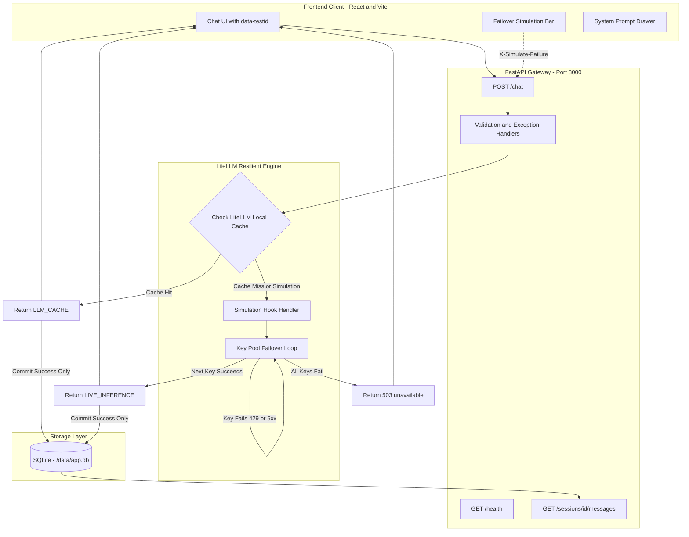
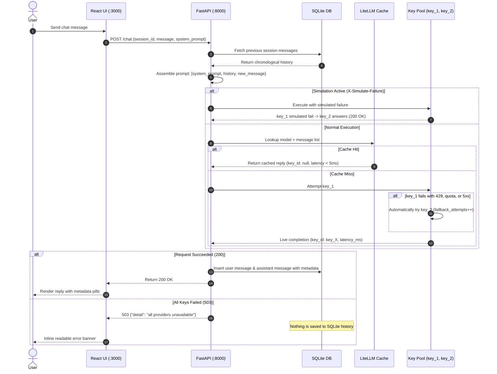

# Lyftr AI — Full-Stack LLM Chatbot with Key Failover & Response Caching

A resilient, production-ready AI chat application built with **React**, **FastAPI**, **LiteLLM**, and **SQLite**. Designed from the ground up for high availability, zero unhandled errors, smart cost/speed optimization via caching, and multi-turn state preservation.

---

## 1. Live URLs

- **Live Frontend:** [https://lyftr-chatbot.vercel.app](https://lyftr-chatbot.vercel.app)
- **Backend API Base URL:** [https://lyftr-chatbot-backend.onrender.com](https://lyftr-chatbot-backend.onrender.com)
- **Health Check Endpoint:** [https://lyftr-chatbot-backend.onrender.com/health](https://lyftr-chatbot-backend.onrender.com/health)
- **GitHub Repository:** [https://github.com/AditiVerma-code/lyftr-llm-chatbot](https://github.com/AditiVerma-code/lyftr-llm-chatbot)

---

## 2. Run Locally

### With Docker (One Command)

```bash
# Clone the repository
git clone https://github.com/AditiVerma-code/lyftr-llm-chatbot.git
cd lyftr-llm-chatbot

# Start the full stack (backend on :8000, frontend on :3000)
make up
```

- **Frontend:** http://localhost:3000
- **Backend API:** http://localhost:8000
- **Health Probe:** http://localhost:8000/health

To stop: `make down`

---

### Without Docker

#### Backend
```bash
cd backend
python -m venv .venv

# Activate environment (Windows: .venv\Scripts\Activate.ps1 | Mac/Linux: source .venv/bin/activate)
.\.venv\Scripts\Activate.ps1

pip install -r requirements.txt
uvicorn app.main:app --host 0.0.0.0 --port 8000 --reload
```

#### Frontend
```bash
cd frontend
npm install
npm run dev
```

#### Run Test Suite
```bash
cd backend
python -m pytest -v
```

---

## 3. Design Decisions: Key Fallback, Caching, SQLite Session Storage

### Architecture Overview



---

### Request & Failover Lifecycle



---

### How Key Fallback Works
- I structured the key pool as an ordered list (`key_1`, `key_2`, ...) parsed from `LLM_API_KEYS`.
- When an LLM request fails due to rate limits (HTTP 429), quota depletion, network drops, or 5xx server issues, the gateway intercepts the error, increments `fallback_attempts`, and immediately retries the next key in the pool.
- The user never experiences an unhandled exception or broken interface.
- If all keys fail, the system returns a clean `503 {"detail": "all providers unavailable"}` without saving the failed message to session history.
- API keys are never leaked to the client; only the safe key identifier (`key_1`, `key_2`) is returned.

### How Response Caching Works
- Enabled LiteLLM's local built-in cache (`type="local"`).
- The cache key is computed from the selected model and the exact message array (system prompt + history + new user message).
- When a cache hit occurs:
  - `resolution_source` is set to `LLM_CACHE`.
  - `key_id` is set to `null`.
  - `fallback_attempts` is `0`.
  - Stored tokens from the original call are returned.
  - Server latency is ultra-fast (< 5ms).
- When `X-Simulate-Failure` is used, caching is bypassed to ensure failover logic can be tested deterministically.

### SQLite Storage & Integrity
- Pure SQLite storage with zero external services (no Redis, no Postgres).
- Table schema:
  ```sql
  CREATE TABLE messages (
    id INTEGER PRIMARY KEY AUTOINCREMENT,
    session_id TEXT NOT NULL,
    role TEXT NOT NULL,
    content TEXT NOT NULL,
    metadata TEXT,
    created_at TEXT NOT NULL
  );
  CREATE INDEX idx_messages_session ON messages (session_id, id);
  ```
- **Transaction Guarantee:** Messages are inserted only after a successful 200 completion. Any request that fails with 422 or 503 is discarded and never touches the database.
- `GET /sessions/{session_id}/messages` retrieves stored history chronologically without the system prompt, returning `404 {"detail": "session not found"}` if the session is unknown.

---

## 4. Verification

### 1. Health Probe
```bash
curl -X GET http://localhost:8000/health
```
```json
{ "status": "ok", "keys_configured": 2, "cache_enabled": true }
```

### 2. Cache Hit (`LLM_CACHE`)
Send the first message in session `s-1`:
```bash
curl -X POST http://localhost:8000/chat \
  -H "Content-Type: application/json" \
  -d '{"session_id": "s-1", "message": "What is the capital of France?"}'
```
*Returns `LIVE_INFERENCE`, `key_id: "key_1"`.*

Send the exact same message in a new session `s-2`:
```bash
curl -X POST http://localhost:8000/chat \
  -H "Content-Type: application/json" \
  -d '{"session_id": "s-2", "message": "What is the capital of France?"}'
```
*Returns `LLM_CACHE`, `key_id: null`, identical reply text, and sub-millisecond latency.*

### 3. Key Failover (`X-Simulate-Failure: key_1=429`)
```bash
curl -X POST http://localhost:8000/chat \
  -H "Content-Type: application/json" \
  -H "X-Simulate-Failure: key_1=429" \
  -d '{"session_id": "s-3", "message": "Testing failover"}'
```
*Returns 200 with `key_id: "key_2"` and `fallback_attempts: 1`.*

### 4. Provider Exhaustion (`X-Simulate-Failure: *=429`)
```bash
curl -X POST http://localhost:8000/chat \
  -H "Content-Type: application/json" \
  -H "X-Simulate-Failure: *=429" \
  -d '{"session_id": "s-4", "message": "Must fail"}'
```
*Returns 503 `{"detail": "all providers unavailable"}`. `GET /sessions/s-4/messages` returns 404 because nothing was written to history.*

---

## 5. Setup Used

- **Development Environment:** Antigravity IDE (VS Code based AI-first editor).
- **Core Tech Stack:**
  - Backend: Python 3.11, FastAPI, LiteLLM, Pydantic V2, Pytest, SQLite.
  - Frontend: React 19, Vite, Lucide React, Modern CSS Design System.
  - Deployment: Multi-stage Docker, Nginx, Docker Compose.

---

## 6. Bonus Features

I added several practical capabilities to make testing and using the chatbot intuitive:

1. **Interactive Failover Simulation Toolbar in the UI:**
   Instead of requiring reviewers to manually write `curl` commands with custom headers, I built a one-click simulation toolbar with buttons for `Normal`, `key_1=429`, `key_1=500`, `*=429`, and custom header inputs. This allows verifying failover directly in the browser during live evaluations.

2. **Real-time Server Health & Key Count Badge:**
   The UI header monitors `/health` to show real-time connection status, active key counts, and cache availability.

3. **Collapsible System Prompt Drawer (`data-testid="system-prompt-input"`):**
   Allows setting a custom system prompt per session to verify how changing system instructions creates separate cache keys.

4. **Built-in Mock LLM Mode (`MOCK_LLM=true`):**
   I implemented an intelligent mock completion engine for offline testing and CI/CD runs so the entire stack can be verified locally without requiring paid API credits.

5. **Clean Dark Theme & Responsive Glassmorphic UI:**
   Color-coded badges (`LLM_CACHE` emerald green vs `LIVE_INFERENCE` electric blue), latency indicators, and token breakdowns for an intuitive user experience.
